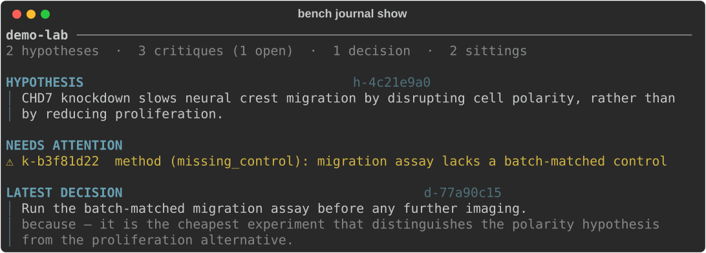

<div align="center">
  <picture>
    <source media="(prefers-color-scheme: dark)" srcset="docs/assets/logo-dark.svg">
    
  </picture>

  <h1>benchside</h1>

  <p><b>An AI workspace for doing science.</b></p>

  <p>
    
    
    
  </p>
</div>

benchside gives you Claude Code skills that act like the people and rituals of
real scientific practice. `/pi` is a supervisor meeting: what's the actual
question, what would change your mind, what's the cheapest experiment that
could kill your hypothesis. The persona recommends; you decide.

The conversation is just conversation — but the record is real. Every
hypothesis, critique, decision, and dead end lands as a typed event in a local
journal, so the next sitting picks up where you left off, and you can always
ask the record what happened.

<div align="center">
  
</div>

## Install

```bash
uv tool install git+https://github.com/science-works/benchside

bench setup    # once per machine: installs the /bench-init skill
```

Then, in a research project directory:

```bash
bench init     # or run /bench-init inside a Claude session
```

`init` asks before writing anything. It sets up the project id, two session
hooks (memory injection, transcript archival), and the `/pi` skill. After
that, open Claude Code and type `/pi`.

## Skills

| Skill | What it is | |
|---|---|---|
| `/pi` | A supervisor meeting | works |
| `/reviewer-2` | An adversarial critic | planned |
| `/exp-design <specialty>` | Experiment co-design with a specialist | planned |

Personas are YAML records — stance, voice, forcing questions, failure modes,
a conversation flow — compiled to skills with `bench compile`. Adding a
specialist is adding a file. See [ARCHITECTURE.md](ARCHITECTURE.md) for how
the rubric derivation and capture enforcement hang together.

## CLI

```text
setup, init, project, compile     get set up
sitting open|status|close         manage the current sitting
hypothesis, critique, resolve,
decide, gap                       record what happened (used mid-sitting)
journal <view>                    query the record
share <action>                    consent, preview, export
recall                            what a persona reads on arrival
```

The capture verbs are mostly called by the model during a sitting; `journal`
and `share` are for you. A sitting can't close as "converged" until it has
actually recorded what the persona was there to get — that's enforced by the
CLI, not by hoping the prompt works.

## Data

Everything lives in `~/.local/share/benchside/` — journals, transcripts, the
consent ledger. Nothing is shared anywhere by default; the export sink
refuses to send even if asked. If you do opt in with `bench share grant`,
`bench share preview` shows the exact bytes an export would contain.

## Development

```bash
uv sync
uv run pytest                    # fast, no API key — run before every commit
uv run ruff check benchside
uv run bench compile --check     # compiled skills must match their sources
```

The project is strict TDD — red test first, including for bug fixes. Design
rationale lives in [ARCHITECTURE.md](ARCHITECTURE.md). `gstack/`, if you see
it locally, is an untracked reference clone of
[gstack](https://github.com/garrytan/gstack); it's not a dependency.

## License

Apache 2.0
